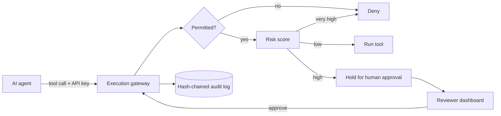

# BankGuard AI: Agent Governance Prototype

A reference prototype showing how a bank could let AI agents call tools safely: permissions, risk-based human approval, and a tamper-evident audit trail.

> Simulated project on synthetic data. Results below are from a small simulated test set, not real bank performance. It is not certified or compliant with any regulation.

## Core idea
The agent is never trusted to enforce its own permissions. Every tool call goes through a separate execution gateway.



## What it does
- **Identity:** API keys map to agent or approver roles (identity comes from the key, never from the request body).
- **Permissions:** each agent can use only its allowed tools.
- **Risk scoring:** weighted 0-100 score decides allow / needs approval / deny.
- **Human approval:** bound to the exact action, expires, single use, and an agent cannot approve itself.
- **Audit log:** hash-chained, stored in SQLite, verifiable through an endpoint.
- **Dashboard:** pending approvals with full details, decision counts, chain integrity.

## Results (simulated)
- Unauthorised-action block rate: [X]% ([a]/[b] attack scenarios)
- False-denial rate on legitimate calls: [Y]%
- Automated tests: [N] passing

## Run it (PowerShell)
```bash
python -m venv .venv
.venv\Scripts\activate
pip install -r requirements.txt
$env:SUPPORT_AGENT_KEY="<random>"
$env:PAYMENTS_AGENT_KEY="<random>"
$env:REVIEWER_KEY="<random>"
uvicorn app.main:app --reload
# second terminal, same REVIEWER_KEY:
streamlit run dashboard/dashboard.py
python -m pytest
```

## Documentation
- [Threat model](docs/threat_model.md)
- [Control matrix](docs/control_matrix.md)

## Known limitations
- API keys instead of OAuth 2.0 / OpenID Connect; no key rotation; no login on the dashboard.
- Hash chaining is tamper-evident, not tamper-proof. Removing the newest entries is not detected without an external anchor.
- Static role-based permissions only; no attribute-based rules.
- SQLite for the prototype; a real system would use a hardened database.
- Small attack set, synthetic data only.

## Roadmap
Kill switch, agent inventory, OAuth/OIDC, external hash anchoring, more attack scenarios.